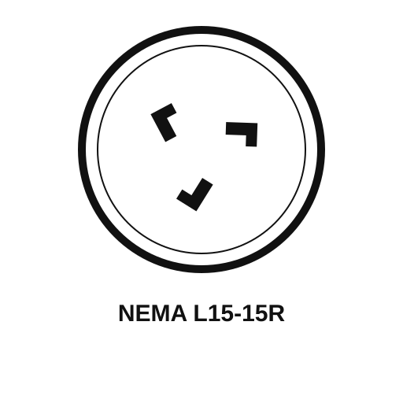
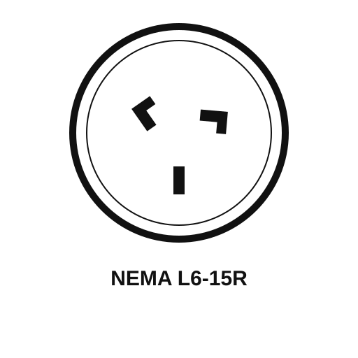
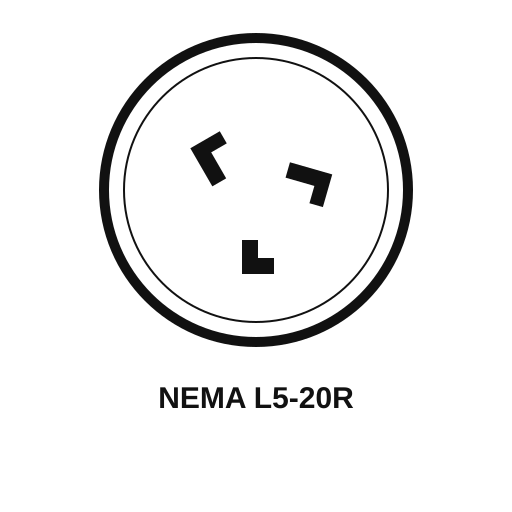

# NEMA Receptacles SVG Collection

Clean, web-ready SVG icons for **NEMA receptacles only** (no plugs).

## Structure

- `standard/` — straight-blade receptacles
- `locking/` — locking (twist-lock) receptacles

All icons use:
- 512×512 viewBox
- circular receptacle face
- monochrome slot geometry
- centered label with the NEMA designation

## Preview

Open `/index.html` for a focused gallery of the corrected reference-scope receptacles.

### Straight-blade receptacles

| Type | Type | Type | Type |
|---|---|---|---|
| NEMA 5-15R | NEMA 6-15R | NEMA 5-20R | NEMA 6-20R |
|  |  |  |  |

### Locking receptacles

| Type | Type | Type | Type |
|---|---|---|---|
| NEMA L15-15R | NEMA L6-15R | NEMA L15-20R | NEMA L5-20R |
|  |  |  |  |
| NEMA L6-20R | NEMA L5-30R | NEMA L6-30R | |
|  |  |  | |
